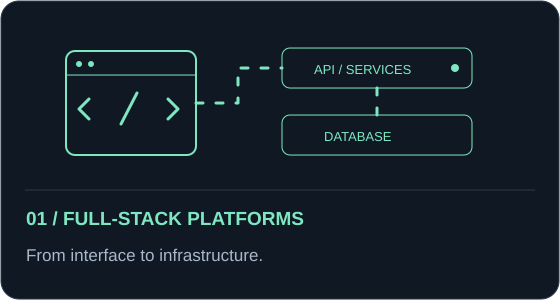
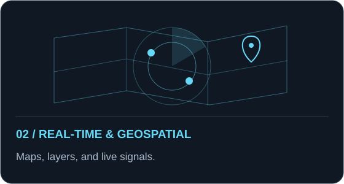
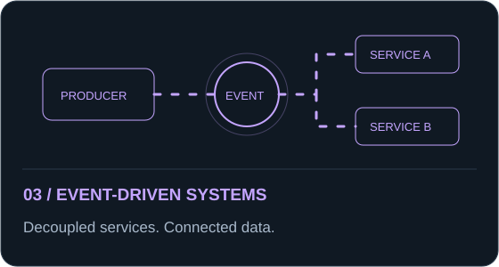
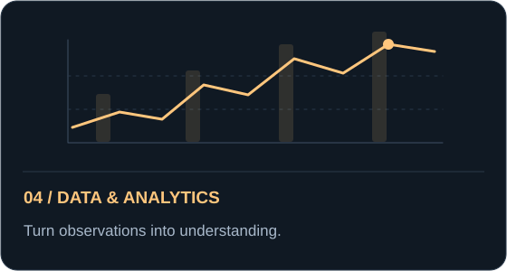
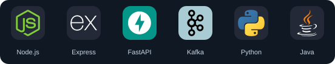
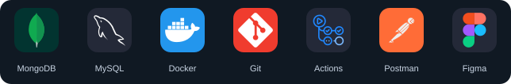
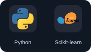

  

    

  
<strong>Full-stack engineering &nbsp; / &nbsp; Real-time systems &nbsp; / &nbsp; Cloud &amp; AI architecture</strong>

  
I build connected software systems, from the interface to the infrastructure.

  <a href="https://github.com/NguyenPhat2412?tab=repositories">Explore repositories ↗</a>
  &nbsp; · &nbsp;
  <a href="#technology">Technology</a>
  &nbsp; · &nbsp;
  <a href="#activity">Activity</a>

 

## 👨‍💻 A little about me

I'm **Nguyễn Xuân Phát** (`@NguyenPhat2412`), a Full-Stack, Cloud & AI Engineer working across frontend applications, backend APIs, real-time data pipelines, and cloud deployment. I care about clear service boundaries, responsive interfaces, and systems that remain understandable as they grow.

- **Building across the stack** — TypeScript, React, Next.js, and React Native interfaces connected to Node.js, Python, and Rust services.
- **Connecting systems** — real-time experiences with WebSocket, Socket.io, and event-driven Apache Kafka pipelines.
- **Thinking beyond delivery** — security, testing, observability, and performance are part of the design.

> Understand the problem. Design with intent. Build, measure, and improve.

## 🚀 What I work on

  
  
  
  

| Focus | Engineering work |
| :--- | :--- |
| **Full-stack platforms** | Typed interfaces, reusable components, API contracts, authentication, and data modeling. |
| **Real-time & geospatial** | Interactive maps, GeoJSON layers, live events, and environmental data visualization. |
| **Event-driven systems** | Kafka producers and consumers, asynchronous processing, and decoupled services. |
| **Data & AI workflows** | Python workflows for data preparation, analysis, visualization, and machine learning. |

Many of my engineering commits happen inside private repositories — the live Bento Dashboard above aggregates **100% of both Public & Private contributions** via GitHub GraphQL API v4 every 6 hours.

<a href="https://github.com/NguyenPhat2412?tab=repositories"><strong>Browse my public work →</strong></a>

## 🛠️ My toolkit

**🎨 Frontend & Mobile** 
React · Next.js · TypeScript · Tailwind CSS · React Native

**⚙️ Backend, Systems & Messaging** 
Node.js · Express · FastAPI · Rust · Kafka · WebSocket · Socket.io

**🐳 Cloud, Data & Delivery** 
AWS · Docker · MongoDB · MySQL · SQL Server · Git · GitHub Actions

**📊 Data Science & AI** 
Python · Pandas · NumPy · Scikit-learn · Matplotlib

<strong>Standalone Stats &amp; Language Cards + Engineering Principles</strong>

 

  
  

| Area | Also in my toolkit |
| :--- | :--- |
| Languages | TypeScript, JavaScript, Python, Rust, Java, HTML, CSS |
| Frontend | Redux, Leaflet, React Leaflet, GeoJSON |
| Analytics | Pandas, NumPy, Scikit-learn, Matplotlib |
| Delivery & tooling | AWS, Docker Compose, Vercel, Render, Postman, Figma |

**How I approach a system**

1. Define responsibilities and the contracts between components.
2. Model data around the domain and its access patterns.
3. Make authentication, authorization, and validation explicit.
4. Design for failures and make behavior observable.
5. Measure before optimizing; introduce complexity when it is needed.

## 🧭 Currently exploring

**System design** · **Distributed systems** · **Scalable APIs** · **Cloud & DevOps**

I'm interested in how architecture, performance, and developer experience come together as a product grows.

## 🐍 Beyond the commits

<picture>
  <source media="(prefers-color-scheme: dark)" srcset="https://raw.githubusercontent.com/NguyenPhat2412/NguyenPhat2412/output/github-contribution-grid-snake-dark.svg" />
  <source media="(prefers-color-scheme: light)" srcset="https://raw.githubusercontent.com/NguyenPhat2412/NguyenPhat2412/output/github-contribution-grid-snake.svg" />
  
</picture>

Dashboard updated every 6 hours by <a href="https://github.com/NguyenPhat2412/NguyenPhat2412/actions/workflows/update-stats.yml">Update Stats Action</a> · Snake generated every 12 hours by <a href="https://github.com/NguyenPhat2412/NguyenPhat2412/actions/workflows/snake.yml">Snake Action</a> · <a href="https://github.com/NguyenPhat2412">View contributions ↗</a>

  

---

  <h3>Good software starts with a good conversation.</h3>
  
Interested in web platforms, developer tools, real-time systems, and open source.

  <a href="https://github.com/NguyenPhat2412?tab=repositories"><strong>Explore what I'm building ↗</strong></a>
    
  NGUYỄN XUÂN PHÁT &nbsp; / &nbsp; BUILD · MEASURE · IMPROVE

<!-- Layout inspiration: https://github.com/MaxRohowsky/best-github-profile-readme
     In particular: adamalston (banner and grouped stack), MacroPower (concise introduction).
     Banner artwork is original and stored in assets/ to avoid an external rendering dependency. -->

<!-- Technology icons: tandpfun/skill-icons (MIT); see assets/icons/LICENSE.
     Animated SVG artwork is original. Motion respects prefers-reduced-motion. -->
